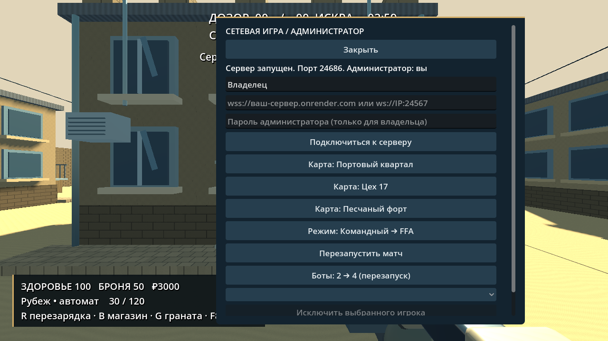
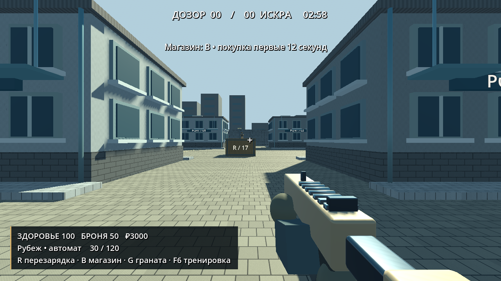

# Рубеж / Game For Me

Оригинальный автономный 3D FPS на Godot 4.4.1 (GDScript). Стилизованная процедурная графика; не копирует ресурсы Standoff 2.

## v0.3.1: функции администратора

В сетевой игре **F8** → после входа с правами администратора доступны **бессмертие**, **бесконечные патроны и гранаты**, **стрельба без отдачи и разброса**, **восстановление здоровья и брони**. Все функции проверяются и применяются сервером только к действующему администратору. При включении все участники видят пометку «АДМИН-РЕЖИМ». По умолчанию выключены. Для этой версии обновите и клиент, и сервер (сетевой протокол 4).

## v0.3.0: мультиплеер, администрирование и бесплатный хостинг

[**Развернуть свой бесплатный сервер на Render**](https://render.com/deploy?repo=https://github.com/vanivanistolin-lab/game-for-me) · [Пошаговая инструкция](hosting/README.md)

В игре нажмите **F8** или «Сетевая игра». Введите `wss://...onrender.com` своего сервера. Владелец вводит секрет **GAME_ADMIN_TOKEN** из настроек своего сервиса Render; другие игроки подключаются без него. Права проверяются сервером. В панели администратора доступны смена карты, перезапуск матча, количество ботов и исключение игрока. До 8 игроков и 6 ботов; для бесплатного хостинга лучше начать с двух ботов.

Кнопка Deploy открывает развёртывание в вашем аккаунте Render, а не уже работающий публичный сервер. Требуется вход владельца и подтверждение бесплатного тарифа. После простоя сервис может засыпать. Проект не регистрирует аккаунт за пользователя и не обещает круглосуточную работу бесплатно.

Также можно создать сервер на своём ПК — его создатель автоматически администратор. Подключение в локальной сети: `ws://IP:24567`. Для игры через интернет без настройки роутера используйте Render. Пароль администратора передаётся по защищённому `wss://` и не сохраняется на компьютере игрока.

Сервер сам рассчитывает перемещение, урон и патроны; клиент не передаёт готовые здоровье или координаты. Офлайн-тренировка **отключена в мультиплеере**; в v0.3.1 действующий администратор получает отдельные серверные переключатели. Это первая сетевая версия с TCP/WebSocket, базовой интерполяцией и без компенсации задержки/профессионального античита.

Графика: карты рельефа и шероховатости, двери, балконы, кабели, дополнительные детали и растения, трассеры и затухающие вспышки, плавное прицеливание и шаговая анимация ботов. Godot 4.4.1 без SSE4.2 и низкое качество сохранены. Улучшение «в пять раз» не измерялось; это не графика уровня CS2.



## Новое в v0.2.0

- Шесть оригинальных текстур материалов, подробные фасады и окружение, небо, дневное освещение, тени и атмосферная глубина.
- Пять отдельных моделей оружия GLB со скруглениями, деталями и снайперским прицелом; экипировка ботов и обновлённое меню.
- Три уровня качества. Для слабого компьютера выберите «Низкое»: отключаются тени и декоративные детали, уменьшается разрешение 3D.
- Встроенная офлайн-тренировка: **F6** или кнопка меню. Бессмертие, бесконечные патроны/гранаты, рамки ботов за стенами, отсутствие отдачи и разброса. Все функции выключены при запуске, матчи с ними помечаются тренировочными. Это функции именно этой игры, без сторонних программ.
- **GameForMe-Setup.exe** устанавливает игру в **C:\game** по умолчанию. Скачайте и запустите установщик, подтвердите запрос Windows и путь. Ничего выполнять в терминале не требуется. Установщик удаляет только собственные файлы игры; посторонние файлы папки не удаляются.
- Обычный EXE и ZIP по-прежнему доступны отдельно. Разработчик не имеет доступа к диску пользователя и не может сам загрузить файл в C:\game.

Это заметное обновление стилизованной графики, а не обещание уровня CS2 или измеримого улучшения «в 50 раз». Фактическая производительность зависит от видеокарты и процессора; на машине пользователя новая версия ещё не проверена.



## Совместимость процессоров (v0.1.1)

Сборка v0.1.0 на Godot 4.6.3 могла завершаться сообщением «A CPU with SSE4.2 instruction set support is required». В v0.1.1 движок и шаблоны экспорта закреплены на Godot 4.4.1, официально поддерживающем Windows x64 без требования SSE4.2. Набор игровых возможностей сохранён. Для исправления скачайте EXE или Windows ZIP версии v0.1.1 или новее; не запускайте старый EXE.

Основание: [официальные требования Godot 4.4 к экспортированным проектам](https://docs.godotengine.org/en/4.4/about/system_requirements.html#exported-godot-project). Фактический запуск на компьютере пользователя пока не подтверждён.

## Скачать и играть без инструментов разработки

После успешной сборки откройте **Actions → Build Windows and Android → успешный запуск → Artifacts**.
- Windows: скачайте GameForMe-Windows, распакуйте внешний архив артефакта и GameForMe-Windows.zip, запустите GameForMe.exe. Godot устанавливать не нужно.
- Android: скачайте GameForMe-Android, распакуйте архив артефакта, установите GameForMe-Android.apk. Android может запросить разрешение установки из выбранного источника. APK использует публичную тестовую debug-подпись, не подходит для Google Play. Для обновления APK из другого запуска CI может понадобиться удалить предыдущую установку.
- После успешного workflow для тега `v*` оба файла доступны непосредственно в **Releases**.

**Статус:** исходники загружены в GitHub. Локальные headless-проверки и Windows-экспорт выполнены. Результат Android-экспорта и публикации проверяйте по успешному запуску Actions и вложениям релиза. Реальные Windows/Android устройства пока не проверены.

## Что реализовано

- Матч с игроком и семью ботами; команды «Дозор» и «Искра»; командный бой и каждый сам за себя.
- Три процедурных варианта арены: портовый квартал, цех, пустынный форт. Общая схема проходов, разные материалы и детали; укрытия, ступени, освещение и тени.
- FPS-камера, движение, бег, прыжок, приседание (снижает камеру и скорость), прицеливание.
- Пистолет, автомат, снайперская винтовка, ПП, дробовик; расход и запас патронов, перезарядка, разброс, отдача, процедурные звуки и эффекты.
- Нож и гранаты с задержкой и проверкой препятствий при взрыве.
- Здоровье, броня, повышенный урон в голову, смерть и возрождение через три секунды.
- Таймер 180 секунд, лимит командного счёта 40, таблица результатов, экран итога, магазин первые 12 секунд.
- Боты ищут видимых противников, строят путь по сетке вокруг препятствий, стреляют, перезаряжаются и отступают при низком здоровье. Три уровня точности/скорострельности.
- Русский интерфейс, пауза, чувствительность и громкость с сохранением.
- Android: левая область экрана — движение, правая свободная область — обзор; отдельные кнопки действий и изменение размера кнопок в меню.

## Управление Windows

WASD — движение; мышь — обзор; ЛКМ — огонь; ПКМ — прицел; R — перезарядка; Space — прыжок; Ctrl — присесть; Shift — бег; 1 — пистолет; 2 — автомат; 3 — удар ножом; G — граната; B — магазин; Tab — счёт; Esc — пауза. Другие виды оружия доступны в магазине.

## Ограничения первой версии

Нет режима закладки бомбы, серий соревновательных раундов, подбора серверов и игроков, компенсации сетевой задержки, сложной тактики укрытий, полноценных анимационных моделей персонажей, фотореалистичных материалов, мини-карты и свободного перемещения сенсорных кнопок. Приседание пока не уменьшает коллизию. Карты используют общий план и требуют художественной доработки. Интерфейс рассчитан на альбомный экран; реальные устройства и производительность на слабых телефонах не проверены. Текущая версия — основа для дальнейшей разработки, а не аналог коммерческого шутера по качеству.

## Разработка и CI

Проект открывается в Godot 4.4.1. Основная сцена — scenes/main.tscn, код — scripts/. Нет внешних зависимостей и обязательных сетевых сервисов.

Проверки для разработчика/CI:

```sh
godot --headless --editor --import --quit
godot --headless --fixed-fps 60 --script res://tests/smoke.gd
```

Smoke-тест проверяет меню, три карты, восемь бойцов, камеру, патроны, перезарядку, урон/броню, убийство, возрождение, сенсорное нажатие/отпускание, движение бота в симуляции и окончание матча. Не заменяет визуальную проверку и тестирование на устройствах.

Workflow закрепляет Godot и export templates версии 4.4.1, проверяет SHA-512 архивов, использует JDK 17, Android platform 35/build-tools 35.0.0. Собирает Windows x64 и Android ARMv7/ARM64, проверяет PE-заголовок EXE, подпись и идентификатор APK, публикует артефакты. Экспорты и подпись APK проверяются при каждом запуске CI. Release job получает право contents:write только для релизного тега; PR-сборки работают с read-only доступом. Для сборок секреты не требуются, debug-ключ создаётся заново на runner. Для прав администратора выделенного сервера Render генерирует GAME_ADMIN_TOKEN, который хранится только в настройках хостинга.

Ресурсы и лицензии: assets/LICENSE.md и LICENSE.

Сетевые проверки: `python3 tests/run_network.py` запускает отдельный сервер и два реальных клиента. Проверяются права, неверный ключ, смена карты, исключение гостя, серверные патроны и ограничения ввода. `godot --headless --script res://tests/collision_parity.gd` сравнивает физическую геометрию и навигацию всех карт клиента и сервера. CI также повторяет сетевые проверки против реально собранного Docker-образа для хостинга.
